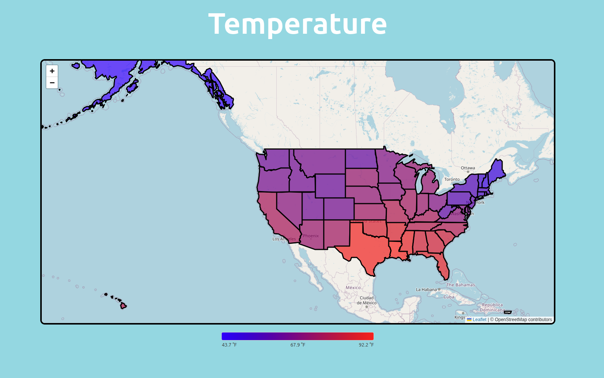
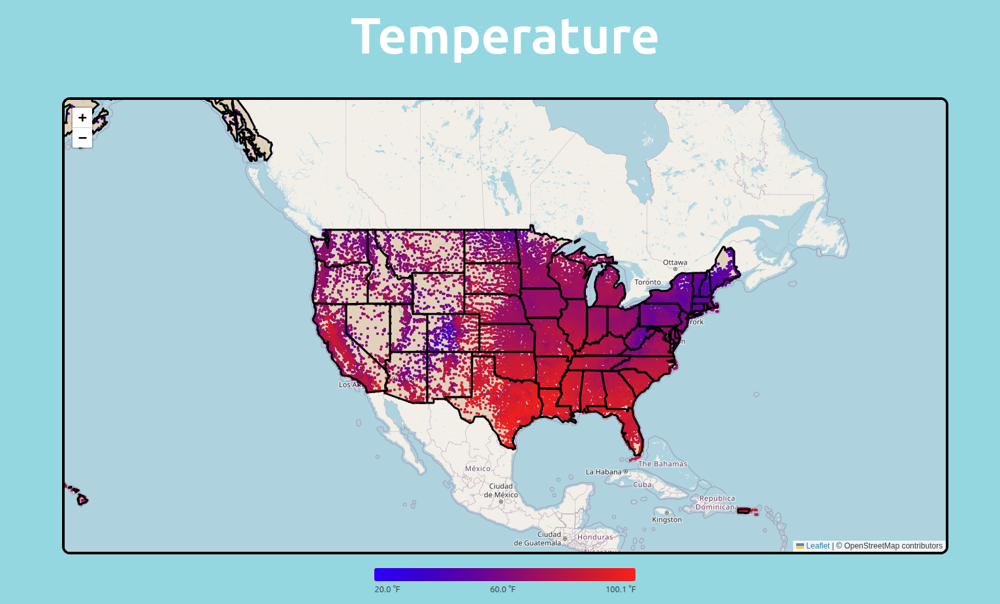

# weather_viz

##### visualizing weather data by states on a spectrum. API: https://www.weatherapi.com/

##### We present Humidity, Wind Speed, and Temperature

##### Visualization by zip code:

##### Click on states on the map to view quantitative data

## How to run

please establish a mongoDB database
